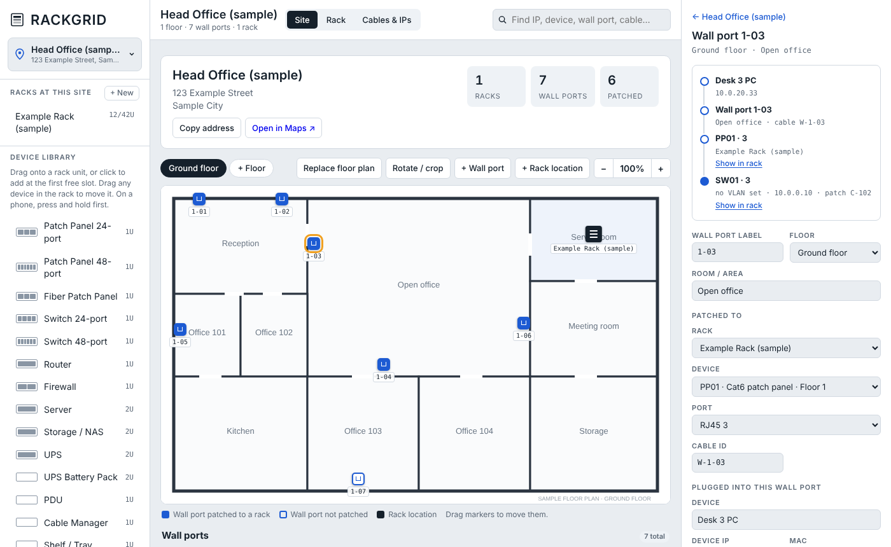
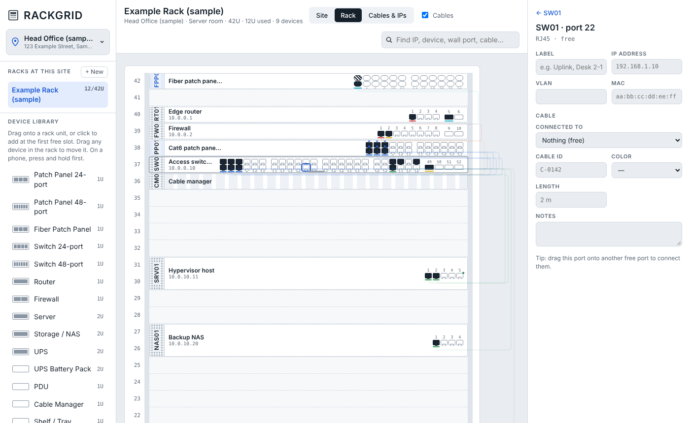

# RackGrid

Track your server racks, network cables, IP addresses, site floor plans and wall ports in the browser, on your own or with your team.

- **Personal Workspace**: private to this device. No sign-up and no server: your data stays in your browser.
- **Team Workspace**: shared with your organization through your own Supabase project, with invitations, roles, live updates, activity history and offline support. See [SETUP.md](SETUP.md).





## Features

- **Workspaces**: choose Personal or Team on launch, and switch any time from the sidebar.
- **Teams**: create a team, invite people with a link or code, and give them Owner, Administrator or Member roles. You can belong to several teams.
- **Live updates**: changes to racks, sites, floor plans, wall ports and access points appear for everyone within a second. Simultaneous edits to the same rack are merged.
- **Activity history**: see who moved, added, removed, connected or patched what, and when. Filter by site, rack or person.
- **Offline support**: keep working without a connection. Changes queue on your device and sync when you reconnect, and the app opens offline once loaded.
- **Bring your data**: copy your Personal Workspace into a new team in one click.

- **Sites**: switch between buildings with the site menu. Each site has an address (with an Open in Maps link), a contact, notes and floors.
- **Floor plans**: upload a PNG, JPG, WebP, SVG or PDF for each floor, then rotate, straighten and crop it.
- **Wall ports**: place jacks on the floor plan (1 port by default, up to 12 per plate, labelled A, B, C…) and patch each port to a patch panel port. Click a wall port to trace it: device → wall port → patch panel → switch port and VLAN.
- **Access points**: place wireless access points on the floor plan with model, IP, MAC, SSIDs, Wi-Fi bands, PoE and a rough coverage circle. Connect each one to a wall port or a rack port and trace it to its switch port.
- **Racks**: drag devices from the library into rack units, drag them to move, and drag a device's bottom edge to resize it. The library includes patch panels (24 and 48 port), fiber panels, switches, routers, firewalls, servers, NAS, UPS, UPS battery packs, PDUs, cable managers, shelves, blanks and custom devices with any height and port count.
- **Cables**: connect ports by clicking or dragging. Drag one end of a cable to another port to re-patch it while the other end stays put. Record cable ID, color and length.
- **IP addresses**: record management IPs, port IPs and the devices plugged into wall ports. Duplicate IPs across a site are flagged.
- **Battery tracking**: record install and replace-by dates for UPS units and battery packs, with overdue warnings.
- **Search** across devices, ports, wall ports, IPs, MACs and cable IDs.
- **Import and export**: full JSON backups (including floor plan images), CSV export of cables, IPs and wall ports, and CSV import of device lists.
- Works on desktop and mobile, in light and dark mode.

## Run it

**Locally:** open `index.html` in Chrome, Edge, Firefox or Safari. Personal Workspace works straight away; Team Workspace and offline caching need the app served over https, e.g. GitHub Pages.

**On GitHub Pages:**

1. Create a new repository on GitHub, for example `rackgrid`.
2. Upload everything in this folder, keeping the `docs`, `supabase` and `vendor` folders (Add file → Upload files), then commit.
3. Go to **Settings → Pages**. Under **Build and deployment**, choose **Deploy from a branch**, select `main` and `/ (root)`, then click **Save**.
4. After a minute your copy is live at `https://<your-username>.github.io/rackgrid/`.

On first open, choose **Open Personal Workspace**, then **Try with sample data** to explore, or **Add a site** to start with your own. To use Team Workspaces, follow [SETUP.md](SETUP.md) once.

## Where your data is stored

**Personal Workspace:** everything stays in **your browser** on the computer you're using. Sites and racks are kept in local storage, and floor plan images in IndexedDB. Nothing is sent to GitHub or anywhere else.

That means:

- Each browser and each computer has its own separate data.
- Clearing your browser's site data deletes it.
- **Use Backup (.json) regularly.** The backup includes floor plan images. Use **Import…** to restore it in another browser or on another computer.

**Team Workspace:** racks and sites are stored in your Supabase project, and floor plans in its private storage bucket. A copy is cached in each member's browser for offline use. Only members of a team can read it.

Don't commit backups to a public repository. They contain your network layout and IP addresses.

## CSV device import

```csv
name,type,u,height,ip,model,serial,rj45,sfp,lc
SW01,switch48,40,1,10.0.0.2,Cisco C9200-48T,FOC1234,48,4,0
SRV01,server,30,2,10.0.10.11,Dell R650,,4,0,0
KVM01,custom,28,1,,KVM switch,,8,0,0
```

Types: `patch`, `patch48`, `fiber`, `switch`, `switch48`, `router`, `firewall`, `server`, `nas`, `ups`, `battery`, `pdu`, `manager`, `shelf`, `blank`, `custom`. Leave `u` blank to use the first free slot.

## Files

| File | What it is |
|---|---|
| `index.html` | The whole app |
| `config.js` | Your Supabase project URL and anon key (optional) |
| `supabase/schema.sql` | Database tables, security rules and functions for Team Workspaces |
| `SETUP.md` | Step-by-step Team Workspace setup |
| `sw.js`, `manifest.webmanifest`, `icon.svg` | Offline support and install-as-app |
| `vendor/supabase.js` | Supabase client library v2.99.3, bundled so the app also works offline |

## Tech

Plain HTML, CSS and JavaScript with no build step. It loads fonts from Google Fonts, and loads PDF.js from cdnjs only when you import a PDF floor plan. Team Workspaces use Supabase (Postgres with Row Level Security, Auth, Realtime and Storage).
